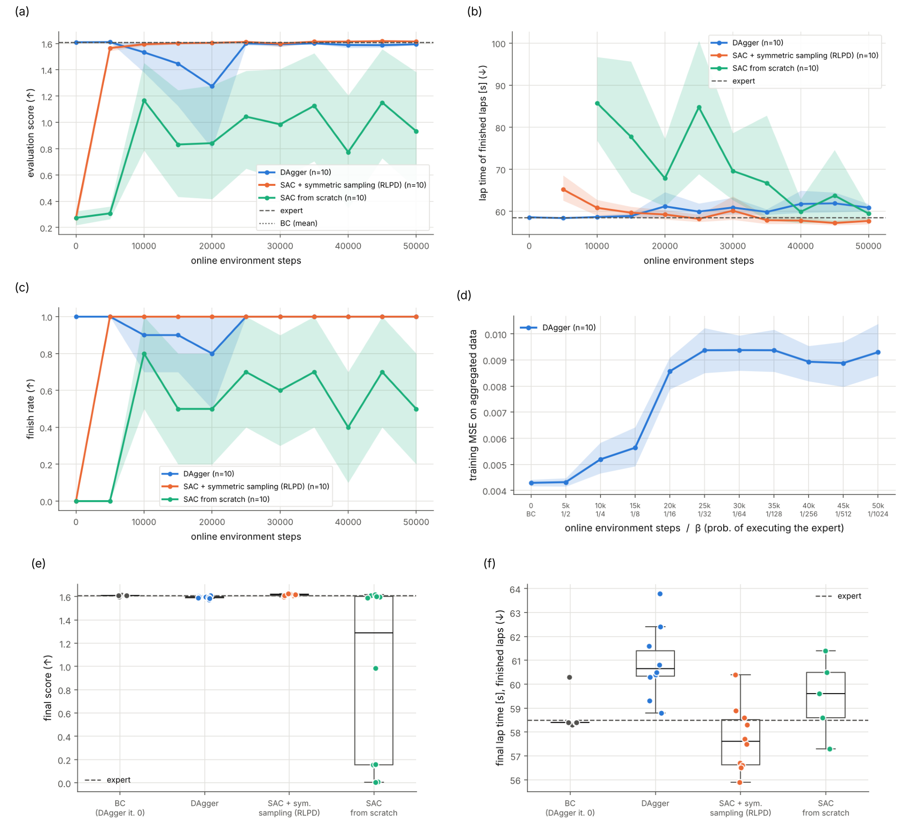

# 1. Question and summary

We compare two ways of using a hand-written expert driver to train a neural policy
for SuperTuxKart (STK). The first is **DAgger**, interactive imitation learning that
queries the expert in the states the learner visits. The second is **SAC with
symmetric sampling** (RLPD), off-policy RL in which half of every batch comes from a
fixed expert dataset. Task: one kart, alone on one track, completes one lap as fast as
possible; opponent-related items are ignored. Both methods share the expert dataset
D0, the actor network, the observation features and normaliser, the online budget and
the evaluation seeds. Every condition is replicated over 10 training seeds.

**Main result.** SAC + symmetric sampling obtains the higher final score (Welch p = 0.0001, Mann–Whitney p = 0.0007). Mean lap time: RLPD 57.7 s, DAgger 60.9 s, BC 58.6 s, expert 58.5 s. See Sections 4–5.

# 2. Conceptual comparison

**Behaviour cloning (BC)** fits the expert's state–action pairs by supervised learning.
At test time the learner visits states produced by its own errors, which were absent
from the training data, so errors compound: the cost grows as $O(\varepsilon T^2)$
(Ross & Bagnell, 2010). **DAgger** (Ross et al., 2011) runs the mixture
$\beta_i \pi^* + (1-\beta_i)\hat\pi_{i-1}$, labels every visited state with the
expert action, aggregates the data and retrains. The cost becomes $O(\varepsilon T)$,
but the expert must be queryable in any state, and the result is at best the expert.
**RLPD** (Ball et al., 2023) trains SAC online from scratch, with 50 % of each batch
drawn from the prior data. It uses no offline pre-training, LayerNorm critics and a
min over a random subset of a critic ensemble against over-estimation. It needs a
reward but never queries the expert again, and since it optimises the return it can
beat the demonstrator.

| | DAgger | SAC + symmetric sampling (RLPD) |
|---|---|---|
| learning signal / expert access | supervised labels, expert queried at every step | reward (TD) + fixed transitions D0 |
| ceiling | expert performance | reward-optimal policy (can beat the expert) |
| main failure modes | non-realisable expert (hidden state, unobserved inputs) | critic over-estimation, RL instability |
| compute | cheap supervised updates | UTD critic updates per env step |

*Hypotheses.* H1: DAgger learns faster (area under the curve). H2: RLPD can beat the
expert, DAgger cannot. H3: both beat BC; RLPD beats SAC without prior data.

# 3. Setup

**Environment.** `STKRaceEnv` from the course repository (commit `ddf2cb6`),
`num_kart=1`, track **`abyss`** for training and evaluation, one lap. Track
items are kept; nothing is ever fired. An episode terminates at the finish line and is
truncated after 1500 steps (150 s); truncation keeps
bootstrapping (Pardo et al., 2018). The RL reward is that of `pystk2_gymnasium`:
$r_t = (d_t - d_{t-1})/10 - 0.1 + 10\cdot\mathbb{1}[\text{finished}]$, i.e. progress,
time penalty and finishing bonus.

**Observations and actions.** Learned policies see 91 features in the
kart frame: velocity, centre-line vector and distance, max steering angle, lap
progress, the 6 next path segments and the
4 nearest items. Features are standardised with statistics of
D0, frozen and shared. Actions are $a \in [-1,1]^{5}$ for `steer`, `acceleration`, `brake`, `drift`, `nitro`
(binary actions: $a_k > 0$). The same automatic rescue is applied to every learned
policy (speed below 1.0 m/s for
30 steps).

**Expert and dataset.** The five team agents were run alone on the track. Lap times: team2 58.5 s, team4 58.5 s, team5 59.0 s, team3 60.4 s, team1 57.0 s (finishes 40%, crashes without opponents). The expert is **team2** (58.5 s, deterministic).
D0 contains 20 expert episodes (11858 transitions);
in half of them the *executed* action is perturbed (σ_steer =
0.2, σ_accel = 0.1, binary
flips p = 0.05). RLPD uses the executed transitions;
BC/DAgger use the clean expert label of each visited state.

**Methods.** Both train the **same actor** (MLP [256, 256], tanh-Gaussian
head; tanh(mean) at evaluation). DAgger fits tanh(mean) to the expert action by MSE;
its iteration 0 (pure BC on D0, no online step) is the **BC baseline**. *SAC from
scratch* (no prior data) is a control. Every run gets
**50000 online steps**.

| | hyper-parameters |
|---|---|
| **DAgger** | BC init 20000 grad. steps; 10 iterations × 5000 env steps; β_i = 0.5·0.5^(i−1) (per-step mixture); 5000 grad. steps/iteration, warm start; Adam lr 0.0003, batch 256 |
| **RLPD** | offline/online ratio 0.5/0.5; 2 critics MLP [256, 256] + LayerNorm, target min over 2; UTD 2, 1 actor update/step; γ 0.99, τ 0.005, batch 256; lr 0.0003 (actor, critic, α); auto α (init 0.1), target entropy −0.5·|A|; learning starts 1000, no random steps |
| **SAC (control)** | as RLPD with offline ratio 0.0, 5000 random steps, learning starts 5000 |
| **Shared** | 50000 online steps; eval every 5000 steps (3 ep.), final 10 ep.; seeds [0, 1, 2, 3, 4, 5, 6, 7, 8, 9] |

Not equalised: DAgger receives one expert label per step and RLPD one reward per step.
Update counts and wall-clock time are reported. We use 2 critics
and UTD 2 (the paper uses 10 and 20) to fit a CPU budget.

**Evaluation and statistics.** Deterministic policies are evaluated every
5000 steps (3 episodes) and at the end
(10 episodes), on evaluation seeds shared by all runs.
Score = lap progress if the lap is unfinished, $1 + (T_{max} - \text{lap steps})/T_{max}$
if finished. The unit of replication is the training seed. The primary test is the
final score, DAgger vs RLPD, with Welch's t-test and the Mann–Whitney U test (MWU), α = 0.05.
Secondary tests are Holm-corrected. We also report bootstrap 95 % CIs, Hedges' g and
P(A > B).

# 4. Results

| method | final score ↑ | finish rate ↑ | lap time [s] ↓ | AUC ↑ | AUC from 5k ↑ |
|---|---|---|---|---|---|
| BC (DAgger it. 0) | 1.609 [1.607, 1.612] | 1.00 [1.00, 1.00] | 58.6 [58.1, 59.0] | – | – |
| DAgger | 1.594 [1.587, 1.601] | 1.00 [1.00, 1.00] | 60.9 [59.8, 61.9] | 1.549 [1.497, 1.601] | 1.543 [1.486, 1.600] |
| SAC + sym. sampling (RLPD) | 1.615 [1.609, 1.622] | 1.00 [1.00, 1.00] | 57.7 [56.7, 58.7] | 1.483 [1.477, 1.490] | 1.604 [1.600, 1.608] |
| SAC from scratch | 0.933 [0.390, 1.475] | 0.50 [0.12, 0.88] | 59.5 [57.5, 61.5] (5 seeds) | 0.858 [0.559, 1.156] | 0.916 [0.592, 1.240] |

*Table 1.* Mean over 10 seeds [95 % t-interval], final evaluation after 50000 online steps; lap time over finished laps; AUC = mean score over the learning curve ("from 5k": exploratory, without the 0-step point).

| A vs B | metric | A − B [boot. 95 % CI] | Welch p | MWU p | Holm p | g | P(A>B) |
|---|---|---|---|---|---|---|---|
| DAgger vs RLPD | final score | -0.021 [-0.029, -0.013] | 0.0001 | 0.0007 | primary | -2.15 | 0.04 |
| DAgger vs RLPD | AUC | 0.066 [0.022, 0.107] | 0.0182 | 0.1405 | 0.5043 | 1.22 | 0.70 |
| DAgger vs RLPD | AUC from 5k | -0.061 [-0.109, -0.017] | 0.0380 | 0.0757 | expl. | -1.04 | 0.26 |
| DAgger vs BC | final score | -0.015 [-0.022, -0.009] | 0.0006 | 0.0002 | 0.0024 | -1.98 | 0.03 |
| RLPD vs BC | final score | 0.006 [-0.000, 0.011] | 0.0899 | 0.1009 | 0.5043 | 0.79 | 0.71 |
| RLPD vs SAC | final score | 0.683 [0.236, 1.126] | 0.0192 | 0.0025 | 0.0161 | 1.22 | 0.91 |
| RLPD vs SAC | AUC | 0.626 [0.380, 0.863] | 0.0011 | 0.0002 | 0.0022 | 2.03 | 1.00 |

*Table 2.* Key tests over training seeds (all tests: `results/summary.md`). Holm: correction over all secondary tests; "expl.": exploratory, uncorrected.

{width=92%}

# 5. Discussion

**RLPD ends faster than DAgger.** With identical data, network and budget, SAC with
symmetric sampling reaches 57.7 s per lap [56.7, 58.7] and DAgger 60.9 s [59.8, 61.9]
(primary test: Welch p = 10⁻⁴, MWU p = 7·10⁻⁴; P(RLPD > DAgger) = 0.96). Both finish 100 % of the laps. The
evaluation turned out deterministic: the 10 episodes of a policy give identical times.
All the variance therefore comes from training, which is what the tests measure.

**DAgger degraded its own BC initialisation** (58.6 → 60.9 s, slower in all 10 seeds,
Holm p = 0.002). It never ran faster than the expert. Panel (d) shows when this
happens: the training MSE stays at its BC level while β ≥ 1/2, then doubles once the
learner drives most of the time. Score and finish rate collapse transiently around
20k steps (a, c), then plateau below BC. Our interpretation, not tested by ablation:
(i) *there was little distribution shift to fix*: BC already matched the expert to
within one step in 9/10 seeds, partly because the noisy half of D0 already
demonstrates recoveries (as in DART); (ii) *labels in learner-visited states are
harder to imitate*: team2 keeps a hidden stuck/recovery state and uses more track
information than our features, so its actions in off-trajectory states are not a
function of our observation; (iii) *aggregation dilutes the racing line*: at the end
only 11 858 of 61 858 training pairs come from the expert's own trajectories.
Possible fixes: slower β decay, retraining from scratch, re-weighting D0. None of
them would lift DAgger's ceiling above the expert.

**RLPD went beyond the demonstrator.** It finished every lap after only 5k online
steps. At 50k steps, 7 of 10 seeds were faster than the expert (best 55.9 s vs 58.5
s). The mean gain (0.8 s) is not significant against the expert or against BC (Holm
p = 0.50), so H2 is only partially supported. This is the key qualitative difference:
DAgger optimises agreement with the expert, RLPD optimises lap time. Training was
stable: no Q divergence, and α decayed to ≈ 0.003.

**Prior data make RL work here.** SAC without D0 finishes the lap in only 5 of 10
seeds and oscillates strongly (RLPD vs SAC: Holm p = 0.016 for the final score, 0.002
for the AUC). Symmetric sampling removes the exploration problem: the critic sees
high-value transitions from the first update.

**Speed and cost (H1 not supported).** The pre-registered AUC favours DAgger (1.549
vs 1.483, Holm p = 0.50), but only because DAgger starts from BC while SAC starts from
a random actor. Without the 0-step point, RLPD is ahead (1.604 vs 1.543, MWU
p = 0.076, exploratory). A DAgger run took 11 min with 50k expert queries; an RLPD run
took 34 min (98k critic updates) and needed a reward but no further expert access.

**Take-away.** When BC on a noise-augmented dataset already imitates the expert and a
dense reward exists, RL with prior data is preferable: it starts as fast and can only
improve on the expert. DAgger is the tool for compounding errors when no reward is
available, and it suffers when the expert depends on information the learner does
not observe.

**Limitations.** One track and one expert; a single online budget; no per-method
tuning; reduced RLPD (UTD 2, 2 critics), so its results are a lower bound. With one
kart the simulator proved deterministic (identical lap times across the 10 evaluation
episodes of a policy), so robustness to perturbations is not measured.

**Reproducibility.** Code, configuration and all logs: *(add the URL of the public repository)*. All
hyper-parameters are in `configs/default.yaml`; each run stores its configuration,
software versions and evaluation logs in `runs/<algo>/seed_<k>/`. The whole study
runs with `python scripts/run_all.py --with-sac --jobs 3`. Software: python 3.12.16, platform Linux-6.18.40.1-microsoft-standard-WSL2-x86_64-with-glibc2.43, torch 2.15.0+cpu, numpy 2.5.4, gymnasium 1.4.0, pysupertuxkart2 0.7.4, scipy 1.18.1.

# References

Ross & Bagnell, *Efficient Reductions for Imitation Learning*, AISTATS 2010. —
Ross, Gordon & Bagnell, *A Reduction of Imitation Learning and Structured Prediction to No-Regret Online Learning*, AISTATS 2011. —
Ball, Smith, Kostrikov & Levine, *Efficient Online RL with Offline Data*, ICML 2023. —
Haarnoja et al., *Soft Actor-Critic*, ICML 2018. —
Laskey et al., *DART: Noise Injection for Robust Imitation Learning*, CoRL 2017. —
Pardo et al., *Time Limits in Reinforcement Learning*, ICML 2018. —
Agarwal et al., *Deep RL at the Edge of the Statistical Precipice*, NeurIPS 2021.
