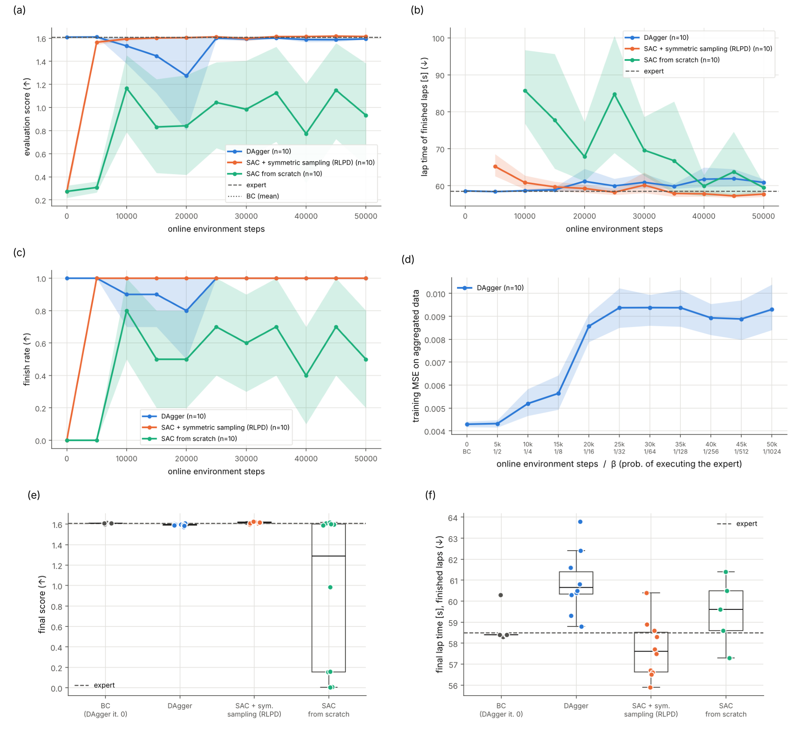

# 1. Question and summary

We compare two ways of using a hand-written expert driver to train a neural policy
for SuperTuxKart (STK). The first is **DAgger**, interactive imitation learning that
queries the expert in the states the learner visits. The second is **SAC with
symmetric sampling** (RLPD), off-policy RL in which half of every batch comes from a
fixed expert dataset. Task: one kart, alone on one track, completes one lap as fast as
possible; opponent-related items are ignored. Both methods share the expert dataset
D0, the actor network, the observation features and normaliser, the online budget and
the evaluation seeds. Every condition is replicated over {{N_SEEDS}} training seeds.

{{HEADLINE}}

# 2. Conceptual comparison

**Behaviour cloning (BC)** fits the expert's state–action pairs by supervised learning.
At test time the learner visits states produced by its own errors, which were absent
from the training data, so errors compound: the cost grows as $O(\varepsilon T^2)$
(Ross & Bagnell, 2010). **DAgger** (Ross et al., 2011) runs the mixture
$\beta_i \pi^* + (1-\beta_i)\hat\pi_{i-1}$, labels every visited state with the
expert action, aggregates the data and retrains. The cost becomes $O(\varepsilon T)$,
but the expert must be queryable in any state, and the result is at best the expert.
**RLPD** (Ball et al., 2023) trains SAC online from scratch, with 50 % of each batch
drawn from the prior data. It uses no offline pre-training, LayerNorm critics and a
min over a random subset of a critic ensemble against over-estimation. It needs a
reward but never queries the expert again, and since it optimises the return it can
beat the demonstrator.

| | DAgger | SAC + symmetric sampling (RLPD) |
|---|---|---|
| learning signal / expert access | supervised labels, expert queried at every step | reward (TD) + fixed transitions D0 |
| ceiling | expert performance | reward-optimal policy (can beat the expert) |
| main failure modes | non-realisable expert (hidden state, unobserved inputs) | critic over-estimation, RL instability |
| compute | cheap supervised updates | UTD critic updates per env step |

*Hypotheses.* H1: DAgger learns faster (area under the curve). H2: RLPD can beat the
expert, DAgger cannot. H3: both beat BC; RLPD beats SAC without prior data.

# 3. Setup

**Environment.** `STKRaceEnv` from the course repository (commit `{{PYSTK_COMMIT}}`),
`num_kart=1`, track **`{{cfg.env.track}}`** for training and evaluation, one lap. Track
items are kept; nothing is ever fired. An episode terminates at the finish line and is
truncated after {{cfg.env.max_steps}} steps ({{MAX_SECONDS}} s); truncation keeps
bootstrapping (Pardo et al., 2018). The RL reward is that of `pystk2_gymnasium`:
$r_t = (d_t - d_{t-1})/10 - 0.1 + 10\cdot\mathbb{1}[\text{finished}]$, i.e. progress,
time penalty and finishing bonus.

**Observations and actions.** Learned policies see {{FEATURE_DIM}} features in the
kart frame: velocity, centre-line vector and distance, max steering angle, lap
progress, the {{cfg.features.n_paths}} next path segments and the
{{cfg.features.n_items}} nearest items. Features are standardised with statistics of
D0, frozen and shared. Actions are $a \in [-1,1]^{{{ACT_DIM}}}$ for {{ACTION_KEYS}}
(binary actions: $a_k > 0$). The same automatic rescue is applied to every learned
policy (speed below {{cfg.env.auto_rescue.speed_threshold}} m/s for
{{cfg.env.auto_rescue.patience}} steps).

**Expert and dataset.** The five team agents were run alone on the track. {{EXPERT_LINE}}
D0 contains {{cfg.dataset.n_episodes}} expert episodes ({{DATASET_N}} transitions);
in half of them the *executed* action is perturbed (σ_steer =
{{cfg.dataset.noise_steer_std}}, σ_accel = {{cfg.dataset.noise_accel_std}}, binary
flips p = {{cfg.dataset.noise_binary_flip}}). RLPD uses the executed transitions;
BC/DAgger use the clean expert label of each visited state.

**Methods.** Both train the **same actor** (MLP {{cfg.network.hidden}}, tanh-Gaussian
head; tanh(mean) at evaluation). DAgger fits tanh(mean) to the expert action by MSE;
its iteration 0 (pure BC on D0, no online step) is the **BC baseline**. *SAC from
scratch* (no prior data) is a control. Every run gets
**{{cfg.budget.online_env_steps}} online steps**.

{{HPARAM_TABLE}}

Not equalised: DAgger receives one expert label per step and RLPD one reward per step.
Update counts and wall-clock time are reported. We use {{cfg.rlpd.n_critics}} critics
and UTD {{cfg.rlpd.utd}} (the paper uses 10 and 20) to fit a CPU budget.

**Evaluation and statistics.** Deterministic policies are evaluated every
{{cfg.budget.eval_every}} steps ({{cfg.budget.eval_episodes}} episodes) and at the end
({{cfg.budget.final_eval_episodes}} episodes), on evaluation seeds shared by all runs.
Score = lap progress if the lap is unfinished, $1 + (T_{max} - \text{lap steps})/T_{max}$
if finished. The unit of replication is the training seed. The primary test is the
final score, DAgger vs RLPD, with Welch's t-test and the Mann–Whitney U test (MWU), α = 0.05.
Secondary tests are Holm-corrected. We also report bootstrap 95 % CIs, Hedges' g and
P(A > B).

# 4. Results

{{RESULTS}}

{width=92%}

# 5. Discussion

{{DISCUSSION}}

**Limitations.** One track and one expert; a single online budget; no per-method
tuning; reduced RLPD (UTD 2, 2 critics), so its results are a lower bound. With one
kart the simulator proved deterministic (identical lap times across the 10 evaluation
episodes of a policy), so robustness to perturbations is not measured.

**Reproducibility.** Code, configuration and all logs: {{REPO_URL}}. All
hyper-parameters are in `configs/default.yaml`; each run stores its configuration,
software versions and evaluation logs in `runs/<algo>/seed_<k>/`. The whole study
runs with `python scripts/run_all.py --with-sac --jobs 3`. Software: {{VERSIONS}}.

# References

Ross & Bagnell, *Efficient Reductions for Imitation Learning*, AISTATS 2010. —
Ross, Gordon & Bagnell, *A Reduction of Imitation Learning and Structured Prediction to No-Regret Online Learning*, AISTATS 2011. —
Ball, Smith, Kostrikov & Levine, *Efficient Online RL with Offline Data*, ICML 2023. —
Haarnoja et al., *Soft Actor-Critic*, ICML 2018. —
Laskey et al., *DART: Noise Injection for Robust Imitation Learning*, CoRL 2017. —
Pardo et al., *Time Limits in Reinforcement Learning*, ICML 2018. —
Agarwal et al., *Deep RL at the Edge of the Statistical Precipice*, NeurIPS 2021.
